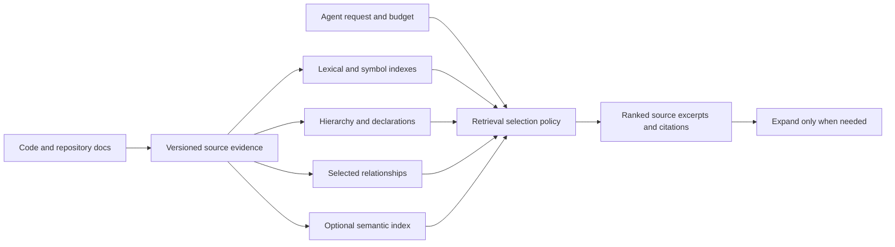

# Efficient agent context from code and repository documentation

## Recommendation

Investigate a selective retrieval engine with several small indexes, a shared source-evidence layer, and progressive expansion. Keep dependency relationships where a request benefits from them. Defer a general graph database, mandatory embeddings, and generated repository summaries until held-out task evaluation justifies them. Following the research pilot, the initial local CLI is implemented in Rust; this is an engineering choice, not a measured Rust-versus-Go result. See the [implementation contract](rust-cli.md).

This is an engineering recommendation, not a demonstrated superiority claim over Graphify. The scientific literature supports useful components but does not establish one universal winner. [Agent Retrieval Bench](https://arxiv.org/abs/2607.24882) finds different retrieval families leading different metrics and task categories; [LocAgent](https://aclanthology.org/2025.acl-long.426/) provides evidence for retaining search and structural navigation together.

The current evidence consists of a [scientific review](evidence.md), [specified evaluation protocol](protocol.md), and [measured retrieval pilot](measured-results.md). The pilot uses three frozen repositories, 30 authored requests, and two output budgets. It is a feasibility experiment with incomplete author-selected judgments, not a representative quality benchmark. Its resource-constrained semantic control truncates more than 90% of chunk inputs at 128 model tokens; it cannot establish the quality ceiling of vector retrieval.

## Findings from the pilot

Across 27 positive requests, BM25 retrieves 57.4% of selected anchors at 2K tokens and 87.0% at 8K. The fixed hybrid retrieves 57.4% and 85.2%; the heuristic graph retrieves 56.8% and 82.7%. These are aggregate recall measurements over minimal annotated lines, not completed-task correctness. Details, category variation, native search, and the separate Graphify navigation control are in the measured results.

At 2K, BM25 and the heuristic graph each retrieve every selected anchor for only 8 of 27 requests. At 8K, BM25 does so for 21. This suggests a concrete next hypothesis: allocate context across documentation, implementation, and tests, then expand when evidence remains missing. It does not establish that a different database or a smaller response alone improves agent efficiency.

Hierarchy performs differently across repositories: its 2K anchor recall is 66.7% in Cobra and 42.6% in Flask. The fixed hybrid does not improve aggregate recall over BM25 in this pilot, so its additional computation is not yet justified by these measurements. All six prototype strategies return context for all three unsupported product questions; answer-level abstention remains untested.

## Where efficiency can come from

Representation, selection, and delivery are separate choices. An inverted index efficiently finds occurrences; symbol tables locate definitions and references; adjacency lists encode relationships; hierarchy gives a coarse overview; embeddings bridge differences in terminology. A tree is a restricted graph, and a reference table also encodes relationships. Replacing a graph database does not necessarily eliminate graph reasoning.

The central objective is sufficient task evidence per unit of total system cost. A short response can omit a constraint and force several later reads. A large response can contain distracting material. Output size, successful-task tokens, and all-attempt cost therefore need separate measurements.

[Agentless](https://arxiv.org/html/2407.01489v2) motivates hierarchical localization and declaration skeletons. [Repoformer](https://arxiv.org/html/2403.10059v1) motivates avoiding unnecessary retrieval, although its completion/serving results do not directly transfer to autonomous agents. [SWE-agent](https://arxiv.org/abs/2405.15793) supports studying the agent interface separately from the index.

## Candidate architecture

The full proposed flow remains a research hypothesis. The Python pilot evaluates retrieval controls, and the initial Rust CLI implements lexical search, compact file location, versioned evidence, and explicit source expansion:

Start with explicit source locations and observed content hashes. Add precise language indexes when needed, distinguishing compiler-resolved relationships from syntactic candidates. Store document sections as evidence units, preserve links and identifier mentions, and retain ambiguous matches rather than converting them into asserted facts.

Use query-specific expansion for dependency questions and a coarse map for orientation. Evaluate optional semantic retrieval for questions whose language differs from the implementation. Test token-budget selection before adding a model-driven compressor. [LongCodeZip](https://arxiv.org/html/2510.00446v1) motivates task-specific selection, but compressor inference must be included in cost and latency.

## Code and product intent

The first scope is code, Markdown/reStructuredText product and API docs, and ADRs inside the repository. It does not include external product systems, PDFs, customer interviews, or hosted synchronization. Markdown plus reStructuredText covers the selected repositories' existing documentation without requiring a generated semantic layer.

| Agent request | Evidence needed | Main failure to test |
| --- | --- | --- |
| Where is this requirement implemented and tested? | Requirement section, relevant implementation, behavioral tests | Similar wording without an implementation link |
| What constraints apply to this change? | Relevant contracts and implementation boundaries | Omitting an exception or backward-compatibility requirement |
| Do the documentation and implementation disagree? | Both source versions and an explicit comparison | Treating an inferred association as a documented requirement |
| Why was this behavior introduced? | An actual ADR, rationale comment, or available source history | Inventing motivation from code alone |

The current pilot locates evidence; it does not answer those questions or establish whether an inferred relationship is correct. Its framework API/user documentation serves as a proxy for documented product constraints; it does not validate retrieval from a representative collection of PRDs, ADRs, or customer research. Repository history is not included in the downloaded tarball corpus, so an undocumented rationale request can legitimately have insufficient evidence. Product intent and observed behavior should remain separate in every eventual response. Report source freshness using observed versions; a recent file timestamp is not proof that its claims are current.

## Graphify comparison

The baseline is the exact commit recorded in `benchmark/corpora.json`, version 0.9.92 in its package metadata. Its CLI already supports output budgets, scoped seeds, and incremental extraction; these are not differentiators that graf can claim merely by implementing them. [Pinned CLI source](https://github.com/Graphify-Labs/graphify/blob/86c57be8204673c2a1b9849a3292a7dd3ab373d8/graphify/__main__.py)

The measured baseline uses fresh code-only extraction without clustering, followed by resident graph queries. It returns navigation hints, whereas the prototypes return source excerpts. Its code-file hint recall and the prototypes' source-anchor recall are different measurements. A docs-enabled semantic Graphify run and complete graph-plus-source agent workflow remain separate comparisons; the local pilot cannot establish that either loses to graf.

Graphify's 2K code-file hint recall is 100% for Cobra and Flask and 88.9% for Fastify in this exploratory set, with fresh graph builds taking approximately 1.8–8.6 seconds in the final run. This is a strong navigation control. The research does not support treating the graph representation itself as the established bottleneck.

## Validation and next decision

Measurement-integrity tests check budgets including citation headers, source hashes and lines, negative-control scoring, unique fault injection, and token accounting. Six synthetic tasks have base-pass, injected-fail, and restored-pass checks. These validate the harness; restoration by the fixture checker is not an agent repair.

End-to-end solver and context/expand interface arms require a specified agent/model, fixed harness command, and inference budget. No paid agent trials or paper-training reproductions have been run. [FastContext](https://arxiv.org/html/2606.14066v1) illustrates why explorer and solver usage must be accounted separately; [CodeGrep](https://arxiv.org/html/2608.05886v1) illustrates why pooled successful-task savings must also be checked on paired instances.

The next architecture decision should use independently reviewed, held-out requests and natural coding issues. Compare ordinary search, the strongest simple retriever, Graphify plus source reads, and the same retriever with progressive delivery. Preserve fallback access. Add complexity only for request categories where it improves execution success or sufficient-evidence coverage enough to justify measured resource cost.
